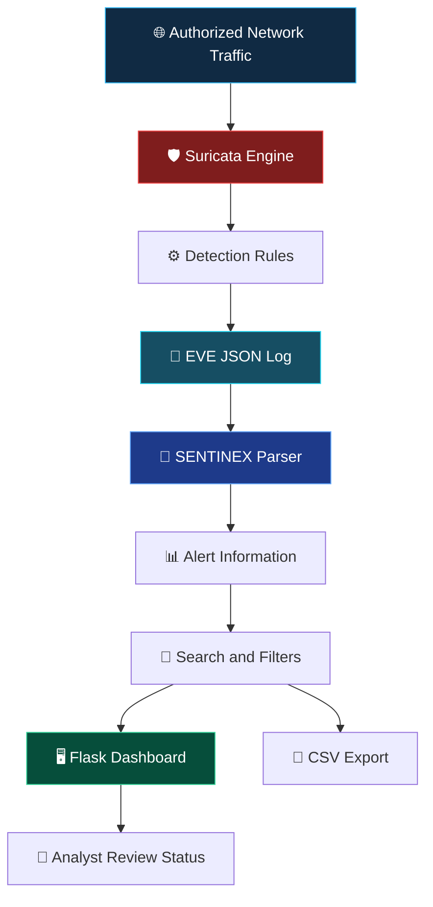

<div align="center">


<br>


**DETECT · ANALYZE · INVESTIGATE · DEFEND**

*A local security dashboard for reviewing Suricata alerts, exploring network events, and organizing defensive triage.*

<br>

[Overview](#-01--project-overview) · [Features](#-02--key-features) · [Architecture](#-03--system-architecture) · [Installation](#-04--installation) · [Testing](#-05--testing)

</div>

---

## ◈ 01 — Project Overview

**SENTINEX** is a Python and Flask-based network intrusion detection and alert-management dashboard.

It reads structured security events from **Suricata's EVE JSON log** and presents them through an organized interface for reviewing network activity.

The dashboard helps users inspect:

* Alert signatures and timestamps.
* Source and destination IP addresses.
* Source and destination ports.
* Network protocols.
* Alert severity values.
* Analyst review status.

> **Internship:** CodeAlpha Cyber Security Internship
> **Assigned Task:** Task 4 — Network Intrusion Detection System.

### 🎯 Project Objective

To understand network intrusion detection, Suricata event logging, alert analysis, and the process of presenting security events through a web-based dashboard.

**Architecture boundary:** Suricata performs the actual network inspection and detection. SENTINEX parses and displays its logged events. SENTINEX does not independently inspect packets or block malicious traffic.

---

## ✦ 02 — Key Features

<div align="center">

| Feature               | Description                                       |
| --------------------- | ------------------------------------------------- |
| 🛡️ Alert Monitoring  | Displays available Suricata alert events.         |
| 🔎 Search             | Helps locate relevant alert records.              |
| 🚦 Severity Filtering | Filters events using recorded severity values.    |
| 📊 Dashboard          | Organizes network alert information.              |
| 📁 CSV Export         | Exports alert records for further analysis.       |
| 📝 Analyst Workflow   | Tracks review status as dashboard metadata.       |
| 📄 EVE JSON           | Reads structured Suricata event records.          |
| 🧪 Demo Data          | Provides simulated records for interface testing. |

</div>

---

## 🧬 03 — System Architecture



### Event Processing Workflow

| Stage | Component     | Responsibility                           |
| ----- | ------------- | ---------------------------------------- |
| 01    | Network       | Provides authorized network traffic.     |
| 02    | Suricata      | Inspects traffic using configured rules. |
| 03    | EVE JSON      | Stores structured event information.     |
| 04    | Python Parser | Reads and processes event records.       |
| 05    | Flask         | Displays parsed alert information.       |
| 06    | Analyst       | Reviews and organizes alert records.     |

---

## 🧰 04 — Technology Stack

| Technology | Purpose                                    |
| ---------- | ------------------------------------------ |
| Python     | Application logic and event processing     |
| Suricata   | Network inspection and intrusion detection |
| EVE JSON   | Structured event logging                   |
| Flask      | Backend web application                    |
| HTML       | Dashboard structure                        |
| CSS        | Dashboard styling                          |
| JavaScript | Frontend interactions                      |
| CSV        | Alert data export                          |

---

## ⚡ 05 — Installation

### Requirements

* Python 3.10 or newer recommended.
* Git.
* Dependencies listed in `requirements.txt`.
* Suricata installed separately for real network detection.
* Appropriate permissions to monitor the selected network interface.

### Windows

```powershell
git clone https://github.com/Prince-0j1/Sentinex-NIDS.git
cd Sentinex-NIDS

py -m venv .venv
.\.venv\Scripts\Activate.ps1

python -m pip install --upgrade pip
pip install -r requirements.txt

python app.py
```

Alternatively, run `run_windows.bat`.

### Linux / macOS

```bash
git clone https://github.com/Prince-0j1/Sentinex-NIDS.git
cd Sentinex-NIDS

python3 -m venv .venv
source .venv/bin/activate

python -m pip install --upgrade pip
pip install -r requirements.txt

python app.py
```

### Open the Dashboard

```text
http://127.0.0.1:5002
```

---

## 🧪 06 — Testing

### Dashboard Demonstration

1. Start SENTINEX.
2. Open the local dashboard.
3. Select **Generate lab demo data**.
4. Confirm that sample alert records appear.
5. Test search and severity filters.
6. Change an analyst review status if available.
7. Export the records as CSV.

**Expected result:** Simulated records appear and the available dashboard workflows can be tested.

### Real Suricata Integration

1. Install Suricata.
2. Configure an authorized network interface.
3. Enable EVE JSON output with alert events.
4. Configure the included local ICMP rule in your lab.
5. Generate permitted test traffic.
6. Check `eve.json` for an event with `"event_type": "alert"`.
7. Configure SENTINEX to read that log.
8. Refresh the dashboard.

**Expected result:** Matching Suricata alert events appear in the dashboard when the configuration and log path are correct.

Official documentation: https://docs.suricata.io/

---

## 🔎 07 — Application Routes

| Route         | Purpose                                      |
| ------------- | -------------------------------------------- |
| `/`           | Main dashboard                               |
| `/health`     | Application health/configuration information |
| `/export.csv` | CSV export of parsed alert records           |

---

## ⚠️ 08 — Scope & Limitations

* Suricata performs the actual network detection.
* SENTINEX displays events recorded by Suricata.
* A rule match does not prove an intrusion succeeded.
* Detection quality depends on network visibility, rule coverage, and configuration.
* False positives and false negatives are possible.
* Analyst status tracking does not block IP addresses or terminate connections.
* Demo records are simulated.
* Use only on networks and devices you own or are authorized to monitor.

---

## 🎓 09 — Learning Outcomes

* Network Intrusion Detection System concepts.
* Suricata configuration and detection rules.
* EVE JSON event processing.
* Python-based log analysis.
* Flask dashboard development.
* Alert investigation and severity classification.
* Defensive security monitoring workflows.

---

## 👨‍💻 Developer

<div align="center">

### PRINCE KOTADIYA

**Cyber Security Student | Python Developer**

Built as part of the **CodeAlpha Cyber Security Internship**.

<br>

**SENTINEX**

*Visibility is the first step in defense.*

<sub>DETECT · ANALYZE · INVESTIGATE · DEFEND</sub>

</div>

---

<div align="center">


</div>
