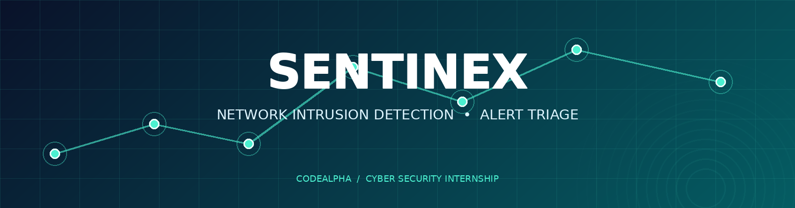
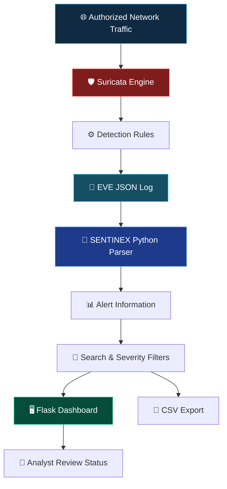

<div align="center">



<br>

# SENTINEX

### NETWORK INTRUSION DETECTION & ALERT TRIAGE

<p>
  
  
  
  
</p>

**DETECT · ANALYZE · INVESTIGATE · DEFEND**

*A local security dashboard for monitoring Suricata alerts, investigating network events, and organizing defensive triage.*

</div>

---

## ◈ Project Overview

**SENTINEX** is a Python-powered network intrusion detection and alert-management dashboard built with Flask.

It reads structured alert events from **Suricata's EVE JSON log** and transforms them into an organized interface where analysts can inspect:

* Alert signatures and timestamps.
* Source and destination IP addresses.
* Source and destination ports.
* Network protocols.
* Alert severity.
* Analyst review status.

> **Internship:** CodeAlpha Cyber Security Internship
> **Assigned Task:** Task 4 — Network Intrusion Detection System.

### ⚡ Important Architecture Boundary

Suricata performs the actual network inspection and rule-based detection. SENTINEX reads, processes, and displays Suricata's logged events.

SENTINEX is an alert visualization and triage dashboard. It does not independently inspect network packets or block malicious traffic.

---

## ✦ Key Features

<table>
<tr>
<td width="50%">

### 🛡️ Alert Monitoring

Displays Suricata alert events with relevant network information.

</td>
<td width="50%">

### 🔎 Smart Search

Searches available alert records to help locate suspicious activity.

</td>
</tr>
<tr>
<td width="50%">

### 🚦 Severity Filtering

Filters alerts according to severity values recorded in the event log.

</td>
<td width="50%">

### 📊 Dashboard Analytics

Presents available alert information in an organized dashboard.

</td>
</tr>
<tr>
<td width="50%">

### 📁 CSV Export

Exports alert records for offline investigation and reporting.

</td>
<td width="50%">

### 📝 Analyst Workflow

Tracks alert review status as dashboard metadata.

</td>
</tr>
</table>

### Additional Capabilities

* EVE JSON event ingestion.
* Configurable Suricata log path.
* Simulated demonstration records.
* Local Flask dashboard.
* Alert investigation workflow.

---

## 🧬 System Architecture

The following diagram illustrates the relationship between Suricata and the SENTINEX dashboard.



### Event Processing Workflow

| Stage | Component     | Responsibility                           |
| ----- | ------------- | ---------------------------------------- |
| 01    | Network       | Provides authorized network traffic.     |
| 02    | Suricata      | Inspects traffic using configured rules. |
| 03    | EVE JSON      | Stores structured event information.     |
| 04    | Python Parser | Reads and processes event records.       |
| 05    | Flask         | Presents the parsed information.         |
| 06    | Analyst       | Reviews and organizes alert records.     |

---

## 🧰 Technology Stack

| Technology | Purpose                                    |
| ---------- | ------------------------------------------ |
| Python     | Application logic and event processing     |
| Suricata   | Network inspection and intrusion detection |
| EVE JSON   | Structured event logging                   |
| Flask      | Backend web application                    |
| HTML       | Dashboard structure                        |
| CSS        | Dashboard styling                          |
| JavaScript | Frontend interactions                      |
| CSV        | Alert data export                          |

---

## ⚡ Installation & Setup

### Requirements

* Python 3.10 or newer recommended.
* Git.
* Dependencies listed in `requirements.txt`.
* Suricata installed separately for real network detection.
* Appropriate permissions to monitor the selected network interface.

### 1. Clone the Repository

```bash
git clone https://github.com/Prince-0j1/Sentinex-NIDS.git
cd Sentinex-NIDS
```

### 2. Create a Virtual Environment

**Windows PowerShell**

```powershell
py -m venv .venv
.\.venv\Scripts\Activate.ps1
```

**Linux / macOS**

```bash
python3 -m venv .venv
source .venv/bin/activate
```

### 3. Install Dependencies

```bash
python -m pip install --upgrade pip
pip install -r requirements.txt
```

### 4. Start SENTINEX

```bash
python app.py
```

Alternatively, Windows users can try the included `run_windows.bat`.

### 5. Open the Dashboard

```text
http://127.0.0.1:5002
```

---

## 🧪 Testing & Validation

### Test 1 — Dashboard Demonstration

1. Start the Flask application.
2. Open the local dashboard.
3. Select **Generate lab demo data**.
4. Confirm that sample alert records appear.
5. Test search and severity filtering.
6. Change an analyst review status if available.
7. Export the records as CSV.

**Expected result:** Simulated records should appear and allow you to test the dashboard's available features.

> Demo records are simulated interface-testing data. They are not real network detections.

### Test 2 — Real Suricata Integration

1. Install Suricata using its official documentation.
2. Configure Suricata to monitor an authorized network interface.
3. Enable EVE JSON output, including alert events.
4. Review `rules/local.rules`.
5. Load the included local ICMP echo-request rule in your lab configuration.
6. Start Suricata.
7. Generate permitted test traffic, such as an ICMP ping, if supported by your network.
8. Inspect `eve.json` for an event with `"event_type": "alert"`.
9. Configure SENTINEX to read the correct EVE JSON file.
10. Refresh the dashboard and check whether the event appears.

**Expected result:** If Suricata generates a matching alert and SENTINEX is configured to read the correct log, the event should appear in the dashboard.

Official documentation: https://docs.suricata.io/

---

## 🔎 Application Routes

| Route         | Description                                  |
| ------------- | -------------------------------------------- |
| `/`           | Main dashboard                               |
| `/health`     | Application health/configuration information |
| `/export.csv` | CSV export of parsed alert records           |

---

## ⚠️ Security Scope & Limitations

SENTINEX is a learning and defensive monitoring project.

* Suricata performs the actual network detection.
* SENTINEX displays events recorded by Suricata.
* A rule match does not prove that an intrusion succeeded.
* Detection quality depends on network visibility, rule coverage, and configuration.
* False positives and false negatives are possible.
* Analyst status tracking does not block IP addresses or terminate connections.
* Demo alerts are simulated.
* Use only on networks and devices you own or are explicitly authorized to monitor.

---

## 🎯 Learning Outcomes

Through this project, I explored:

* Network Intrusion Detection System concepts.
* Suricata configuration and detection rules.
* EVE JSON event processing.
* Python-based log analysis.
* Flask dashboard development.
* Alert investigation and severity classification.
* Defensive security monitoring workflows.

---

## 👨‍💻 Developer

<div align="center">

### PRINCE KOTADIYA

**Cyber Security Student | Python Developer**

Built as part of the **CodeAlpha Cyber Security Internship**.

</div>

---

<div align="center">

### SENTINEX

**Visibility is the first step in defense.**

<sub>DETECT · ANALYZE · INVESTIGATE · DEFEND</sub>

</div>
