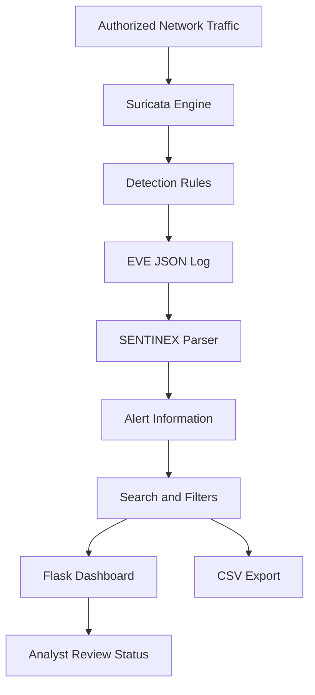

<div align="center">
  
</div>

<br>

<div align="center">
  
  
  
  

  <h3>DETECT · ANALYZE · DEFEND</h3>
  <p><i>A local dashboard for reviewing Suricata alerts, exploring network events, and organizing defensive triage.</i></p>
</div>

---

## ◈ Overview

**SENTINEX** is a Python and Flask dashboard that reads alert events from **Suricata's EVE JSON log** and presents them in an organized interface.

It helps users review alert signatures, timestamps, source and destination addresses, protocols, severity values, and analyst workflow status.

**CodeAlpha Internship Mapping:** Cyber Security — Task 4: Network Intrusion Detection System.

> **Architecture boundary:** Suricata is the network inspection and detection engine. SENTINEX parses and displays Suricata's logged alert events. The dashboard does not independently inspect packets or block network traffic.

## ✦ Features

| Feature            | Description                                                                                     |
| ------------------ | ----------------------------------------------------------------------------------------------- |
| EVE JSON ingestion | Reads structured Suricata event records.                                                        |
| Alert overview     | Displays available signatures, timestamps, IP addresses, ports, protocols, and severity fields. |
| Severity filtering | Filters records using severity values from the event log.                                       |
| Search             | Helps locate relevant alert records.                                                            |
| Analyst status     | Tracks review status as dashboard metadata.                                                     |
| CSV export         | Exports alert records for further analysis.                                                     |
| Demo records       | Provides simulated records for testing the interface.                                           |

## 🧬 Architecture



## 🧰 Technology Stack

* **Python** — application logic and event parsing.
* **Suricata** — network inspection and rule-based detection.
* **EVE JSON** — structured event output.
* **Flask** — local web application.
* **HTML, CSS, JavaScript** — dashboard interface.
* **CSV** — portable alert export.

## ⚡ Installation and Setup

### Requirements

* Python 3.10 or newer recommended.
* Dependencies listed in `requirements.txt`.
* Suricata installed separately for real network detection.
* Permission to monitor the selected network interface.

### Windows Installation

Clone the repository:

```powershell
git clone https://github.com/Prince-0j1/Sentinex-NIDS.git
cd Sentinex-NIDS
```

Enter the application directory:

```powershell
cd CodeAlpha_NetworkIntrusionDetectionSystem
```

Create and activate a virtual environment:

```powershell
py -m venv .venv
.\.venv\Scripts\Activate.ps1
```

Install dependencies:

```powershell
python -m pip install --upgrade pip
pip install -r requirements.txt
```

Start the application:

```powershell
python app.py
```

If provided, you can alternatively use:

```powershell
.\run_windows.bat
```

Open the dashboard:

**http://127.0.0.1:5002**

### Linux / macOS Installation

```bash
git clone https://github.com/Prince-0j1/Sentinex-NIDS.git
cd Sentinex-NIDS/CodeAlpha_NetworkIntrusionDetectionSystem

python3 -m venv .venv
source .venv/bin/activate

python -m pip install --upgrade pip
pip install -r requirements.txt

python app.py
```

Open:

**http://127.0.0.1:5002**

## 🧪 Testing

### 1. Dashboard and Demo Data Test

1. Start SENTINEX.
2. Open `http://127.0.0.1:5002`.
3. Use the **Generate lab demo data** option, if available.
4. Confirm that sample records appear.
5. Test the search and severity filters.
6. Change an analyst status, if the control is available.
7. Export the records to CSV.

**Expected result:** Simulated records should appear, allowing you to test the dashboard's display, filtering, status, and export workflows.

> Demo records are simulated UI test data. They are not actual network detections.

### 2. Real Suricata Log Test

1. Install Suricata using its official documentation: https://docs.suricata.io/
2. Configure Suricata to monitor an authorized network interface.
3. Enable EVE JSON output and include alert events.
4. Review the local ICMP rule in `rules/local.rules`.
5. Load the rule into your lab configuration.
6. Start Suricata and generate permitted test traffic.
7. Inspect `eve.json` for an event containing `"event_type": "alert"`.
8. Configure SENTINEX to read the correct EVE JSON log path.
9. Refresh the dashboard and check whether the alert appears.

The included ICMP rule is intended for basic lab validation, not comprehensive intrusion detection.

## 🔎 Application Routes

The following routes are documented for the application:

| Route         | Purpose                                      |
| ------------- | -------------------------------------------- |
| `/`           | Main dashboard                               |
| `/health`     | Application health/configuration information |
| `/export.csv` | CSV export of parsed alert records           |

## ⚠️ Scope and Limitations

* Suricata performs network detection; SENTINEX displays its logged alert events.
* An alert does not automatically prove that an intrusion succeeded.
* Results depend on network visibility, rule coverage, and Suricata configuration.
* False positives and false negatives are possible.
* Analyst status tracking does not block IP addresses or change firewall rules.
* Demo records are simulated.
* Use only on networks and devices you own or are explicitly authorized to monitor.

## 📚 Learning Outcomes

Through this project, I explored:

* Network Intrusion Detection System concepts.
* Suricata installation and configuration.
* Rule-based network detection.
* EVE JSON log processing.
* Python-based event parsing.
* Flask dashboard development.
* Alert analysis and defensive triage.

---

<div align="center">

### SENTINEX

**Visibility is the first step in defense.**

<sub>Developed as a learning project for the CodeAlpha Cyber Security Internship.</sub>

</div>
