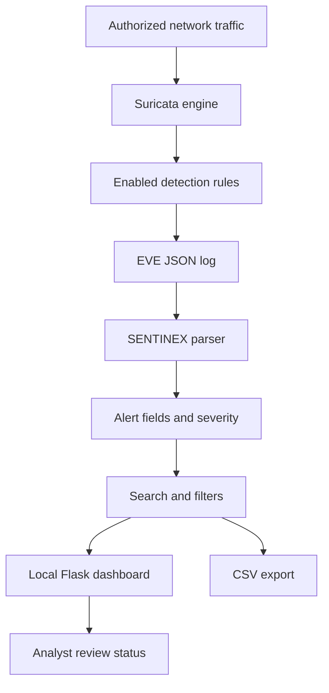

<div align="center">

<p align="center">
  
</p>
<br>


### DETECT · ANALYZE · DEFEND

*A local dashboard for reviewing Suricata alerts, exploring network events, and organizing defensive triage.*

</div>

---

## ◈ Overview

**SENTINEX** is a Python and Flask dashboard that reads alert events from **Suricata's EVE JSON log** and presents them in an organized interface. It helps a user review alert signatures, timestamps, source and destination addresses, protocols, severity values, and analyst workflow status.

> **CodeAlpha internship mapping:** Cyber Security — Task 4, Network Intrusion Detection System.

**Architecture boundary:** Suricata is the network inspection and detection engine. SENTINEX parses and displays Suricata's logged alert events. The dashboard does not independently inspect packets or block traffic.

## ✦ Features

| Feature | What it does |
|---|---|
| EVE JSON ingestion | Reads structured Suricata event records. |
| Alert overview | Displays available signature, timestamp, IP, port, protocol, and severity fields. |
| Severity filtering | Filters records using severity values in the event log. |
| Search | Helps locate relevant alert records. |
| Analyst status | Tracks review state as dashboard metadata. |
| CSV export | Exports alert records for further analysis. |
| Demo records | Provides simulated data to exercise the interface. |

## 🧬 Architecture



## 🧰 Technology

- **Python** — application logic and event parsing.
- **Suricata** — network inspection and rule-based detection.
- **EVE JSON** — structured event output.
- **Flask** — local web application.
- **HTML, CSS, JavaScript** — dashboard interface.
- **CSV** — portable alert export.

## ⚡ Installation

### Requirements

- Python 3.10 or newer recommended.
- Dependencies listed in `requirements.txt`.
- Suricata installed separately for real detection.
- Permission to monitor the selected network and interface.

### Windows

```powershell
git clone https://github.com/<your-username>/Sentinex-NIDS.git
cd Sentinex-NIDS

py -m venv .venv
.\.venv\Scripts\Activate.ps1

python -m pip install --upgrade pip
pip install -r requirements.txt

python app.py
```

Alternatively, run the included `run_windows.bat`.

Open **http://127.0.0.1:5002**.

### Linux / macOS

```bash
git clone https://github.com/<your-username>/Sentinex-NIDS.git
cd Sentinex-NIDS

python3 -m venv .venv
source .venv/bin/activate

python -m pip install --upgrade pip
pip install -r requirements.txt

python app.py
```

Open **http://127.0.0.1:5002**.

## 🧪 Testing

### Dashboard and demo-data test

1. Start SENTINEX and open `http://127.0.0.1:5002`.
2. Use **Generate lab demo data**.
3. Confirm sample rows appear.
4. Test search and severity filters.
5. Change an analyst status if the control is available.
6. Export CSV and open it.

**Expected:** Simulated records appear and the dashboard's display, filter, status, and export workflows operate. Demo records are simulated UI test data, not real detections.

### Real Suricata log test

1. Install Suricata using the [official documentation](https://docs.suricata.io/).
2. Configure it to monitor an authorized interface.
3. Enable EVE JSON output and include `alert` events.
4. Review `rules/local.rules` and load the included local ICMP echo-request rule in your lab configuration.
5. Start Suricata and generate permitted test traffic, such as an ICMP ping if your network allows it.
6. Inspect the configured `eve.json` file for a record where `event_type` is `alert`.
7. Configure SENTINEX to read that exact log path using the dashboard's log-path setting or the project's configuration.
8. Refresh the dashboard and verify that the event appears.

The included ICMP rule is a simple lab validation rule, not a complete detection policy.

## 🔎 Application routes

| Route | Purpose |
|---|---|
| `/` | Main dashboard |
| `/health` | Basic application health/configuration information |
| `/export.csv` | CSV export of parsed alert records |

## ⚠️ Scope and limitations

- Detection is performed by Suricata; SENTINEX presents its logged alert events.
- A rule match is an alert, not proof that an intrusion succeeded.
- Results depend on interface visibility, rule coverage, and Suricata configuration.
- False positives and false negatives are possible.
- Analyst status tracking does not block an IP, terminate a connection, or change firewall rules.
- Demo records are simulated.
- Use only on networks and devices you own or are explicitly authorized to monitor.

## 📚 Learning outcomes

This project introduces network IDS concepts, Suricata rules, EVE JSON parsing, alert triage, Python log processing, and Flask dashboard development.

---

<div align="center">

**SENTINEX — Visibility is the first step in defense.**

<sub>Built as a learning project for the CodeAlpha Cyber Security Internship.</sub>

</div>
